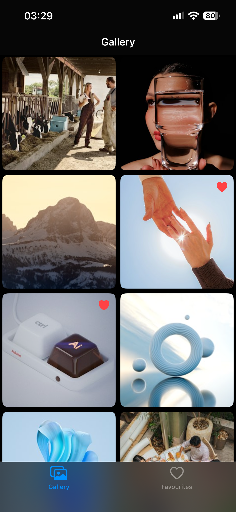
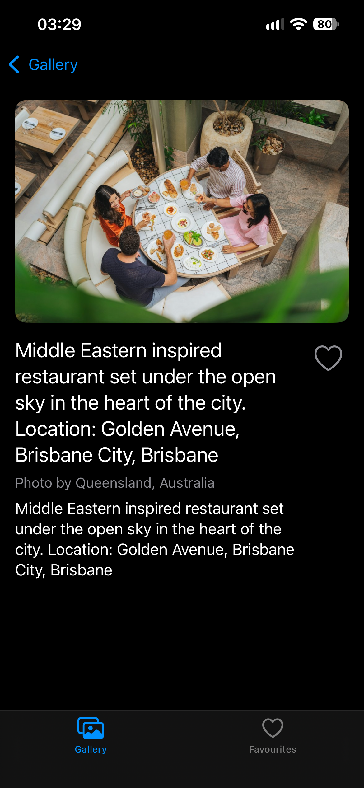
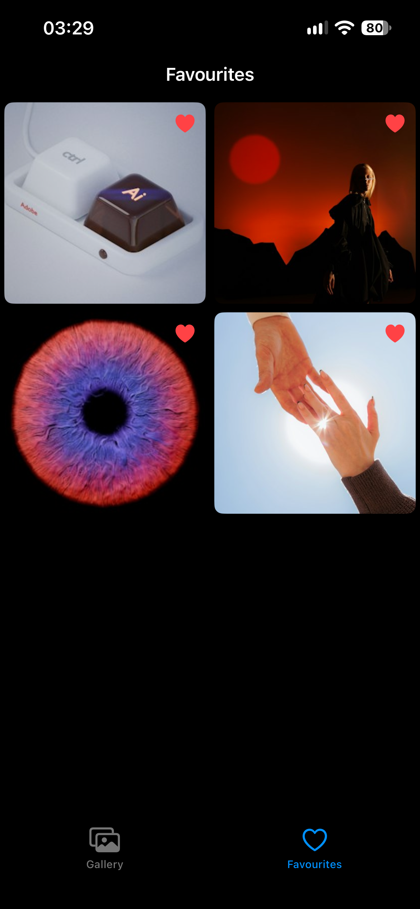

https://github.com/user-attachments/assets/eea143d2-9173-4df3-8453-464ea5cc420d
# GalleryApp

iOS gallery app (UIKit, MVVM) that browses photos from the Unsplash API and lets you keep favourites offline.

**Author:** Diana — [GitHub](https://github.com/idmkr) · [email:korman@gmail.com or tg:@idmfck]

## Screenshots

| Gallery | Detail | Favourites |
|---|---|---|
|  |  |  |
https://github.com/user-attachments/assets/f1d10a0d-1d33-4c82-8e25-2c4cd7d5df3a


## Features

- Photo grid with pagination (30 photos per request, loads more near the end of the list)
- Image caching for smooth scrolling
- Detail screen: large photo, title, author, description
- Swipe left/right between photos on the detail screen
- Favourite button (heart); favourites persisted locally with CoreData
- Heart indicator on favourite thumbnails in the gallery
- Favourites tab: grid, removal via long-press context menu, empty state
- Adaptive layout: column count depends on screen width (iPhone, iPad, landscape)
- Error handling with retry (network, rate limit, decoding)

## Additional (beyond requirements)

- Tab bar navigation (Gallery / Favourites)
- Context menu for removing favourites
- Empty state for the favourites screen
- API key kept out of the repository via `.xcconfig`

## Architecture

**MVVM** with dependency injection.

- `Models` — `Photo` (Codable)
- `Core/Networking` — `PhotosService` over `URLSession` with `async/await`, `NetworkError`
- `Core/ImageLoading` — `ImageLoader` with `NSCache`
- `Core/Persistence` — CoreData stack and `FavouritesRepository`
- `Features/Gallery|Detail|Favourites` — ViewModel + ViewController per screen
- `App` — `MainTabBarController` (composition root)

**Patterns and principles**

- Combine (`@Published`) for ViewModel → View binding
- Protocols for abstraction and testability: `PhotosServiceProtocol`, `NetworkSession`, `ImageLoading`, `FavouritesRepositoryProtocol` (Dependency Inversion)
- Repository pattern for the persistence layer
- Singleton (`ImageLoader.shared`), Delegate (collection view, page view controller), Observer (Combine)
- Single responsibility: each type has one job; screens don't know about CoreData or URLSession

**Frameworks:** UIKit, Combine, CoreData, XCTest. No third-party dependencies.

## Configuration

The app needs an Unsplash API key.

1. Register at https://unsplash.com/developers and create an application to get an **Access Key**.
2. Copy the template:
   ```bash
   cp GalleryApp/Config.example.xcconfig GalleryApp/Config.xcconfig
   ```
3. Open `GalleryApp/Config.xcconfig` and replace `YOUR_ACCESS_KEY_HERE` with your key.
4. Open `GalleryApp/GalleryApp.xcodeproj` and run (iOS 17+).

`Config.xcconfig` is in `.gitignore` and is never committed. The demo key is limited to 50 requests per hour.

## Tests

Run with `⌘U` in Xcode. Unit tests cover `PhotosService` (decoding, auth header, error mapping), `GalleryViewModel` (pagination logic) and `FavouritesRepository` (in-memory CoreData). Network and services are replaced with mocks, so tests need no internet.

## Code style

SwiftLint is configured in `.swiftlint.yml`. Run `swiftlint` in the repository root.

## Git workflow

Gitflow: each feature lives in its own `feature/*` branch and is merged into `main` through a Pull Request. Commit messages use the `[ADDED]`, `[UPDATED]`, `[FIXED]`, `[REFACTORED]` prefixes.
